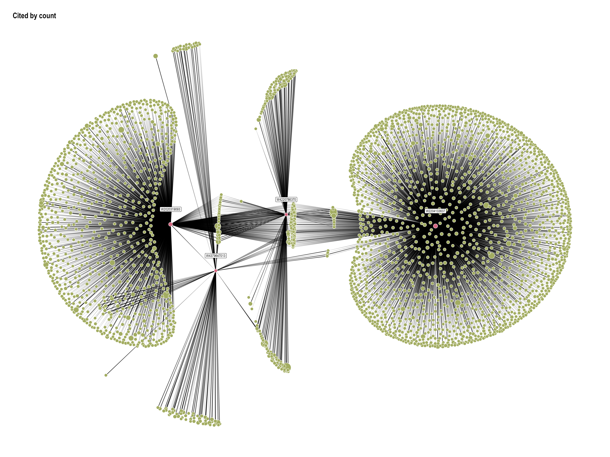
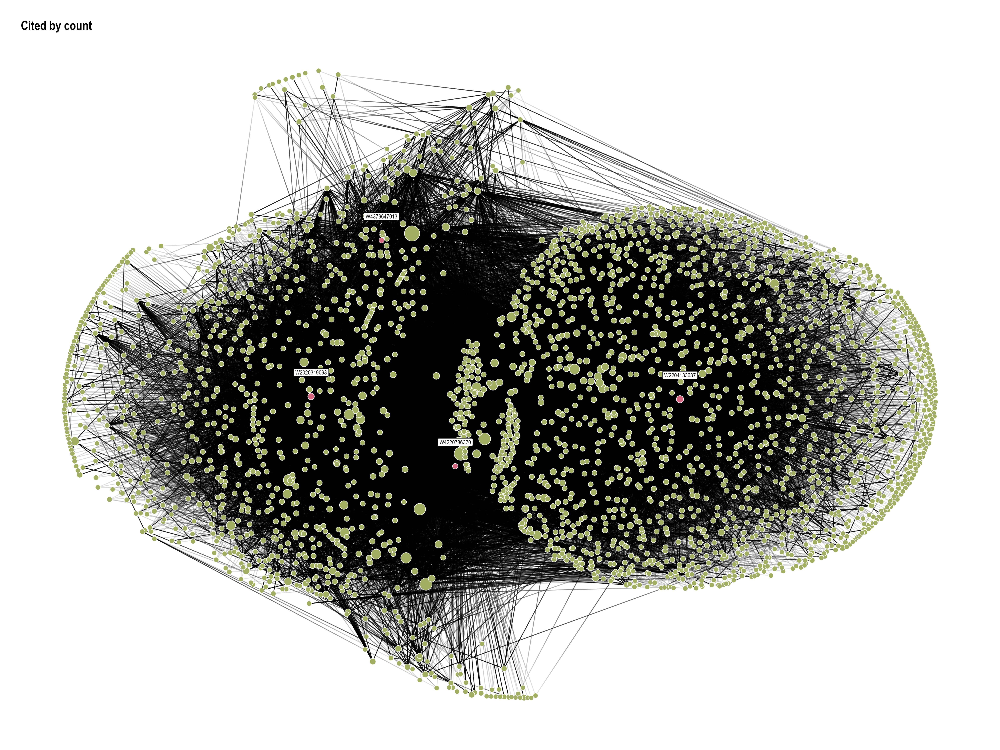

```{r}
#| label: setup
#| include: false
#| echo: true
#|

# This is needed to execute the inline code

if (!require("quarto")) {
    install.packages("quarto")
    library(quarto)
}

if (quarto::quarto_version() < as.numeric_version("1.4.358")) {
    stop(
        "Please upgrade your quarto version to at least 1.4.358 as otherwise the rendering will fail, but the code will run\n"
    )
}
```

[](https://zenodo.org/doi/10.5281/zenodo.10257156)
[](https://creativecommons.org/licenses/by/4.0/)

[](https://github.com/IPBES-Data/IPBES_TG_Snowballing)
[](https://github.com/IPBES-Data/IPBES_TG_Snowballing/releases/latest)
[](https://github.com/IPBES-Data/IPBES_TG_Snowballing/commits/main)


Prepared by

- [Rainer M. Krug](mailto:Rainer@krugs.de) - IPBES Task Force on Knowledge and Data.

Reviewed by

- [Aidin Niamir](mailto:Aidin.Niamir@Senckenberg.de) - IPBES Technical Support Unit for Knowledge and Data
- [Renske Gudde](mailto:Renske.Gudde@Senckenberg.de) - IPBES Technical Support Unit for Knowledge and Data
- [Yanina V. Sica](mailto:Yanina.Sica@Senckenberg.de) - IPBES Technical Support Unit for Knowledge and Data

<!-- - IPBES Task Force on Knowledge and Data**  -->

*For any inquires please contact [Aidin.Niamir@senckenberg.de](mailto:aidin.niamir@senckenberg.de)*

**Version:** `r rmarkdown::metadata$version`

Last updated: `r Sys.Date() |> format("%d %B, %Y")`


## Introduction

Snowball search (also known as chain sampling, chain-referral sampling, referral sampling) is in the context of literature search a search which starts with some key-papers and identifies the papers which are referenced in the key-papers (also called backward search) as well as the papers citing one or more key-papers (also called forward search).

These key-papers should cover the range of the topic which should be covered by the resulting literature corpus, while containing the most relevant papers of the topic, and form the core of the search.
Consequently, the selection of the key-papers is essential and this selection determines the quality and usability of the resulting corpus for a specific question asked.


## Methods


### Databases suitable for Snowballing
In principle, snowballing can be done with most (if not all) literature databases. Examples are Web of Science, Scopus or PubMed which provide the possibility to search for papers from their web interface or using API services. When using their web interface, one can only search for one article at the time, so it is very cumbersome to conduct a snowball search for multiple keypapers. Using the provided APIs of these proprietary databases makes automating the search possible, but becomes easily extremely expensive and still laden with restrictions due to high licence fees.

A good alternative is [OpenAlex](https://openalex.org). [OpenAlex](https://openalex.org) is an open scholarly data source which provides a free daily usage budget for its API (which is enough for most projects, including the snowball search shown here), and the complete database is also available as a free snapshot for download. Therefore, the snowball search can be scripted. API clients are available for many different programming languages, including R (e.g. [`{openalexR}`](https://docs.ropensci.org/openalexR/) and [`{openalexPro}`](https://github.com/openalexPro/openalexPro)) and Python ([pyalex](https://pypi.org/project/pyalex/)).

This technical guideline focuses on the use of [OpenAlex](https://openalex.org) (the data source for literature recommended by the IPBES Technical Support Unit on Knowledge and Data) through the [openalexPro](https://github.com/openalexPro) ecosystem of R packages:

- **[`{openalexPro}`](https://github.com/openalexPro/openalexPro)** provides the access to the OpenAlex API. In contrast to [`{openalexR}`](https://docs.ropensci.org/openalexR/), which processes all data in memory, [`{openalexPro}`](https://github.com/openalexPro/openalexPro) processes the retrieved data on disk and stores it as [Apache Parquet](https://parquet.apache.org) files. The size of a search is therefore limited by disk space rather than by memory.
- **[`{openalexSnowball}`](https://github.com/openalexPro/openalexSnowball)** builds on [`{openalexPro}`](https://github.com/openalexPro/openalexPro) and conducts the snowball search itself. It retrieves the key-papers, the works citing them and the works cited by them, and stores the resulting citation network as nodes (works) and edges (citations) in Parquet.

Further packages in the ecosystem which are useful in this context, but not used in this guideline, are [`{openalexSnapshot}`](https://github.com/openalexPro/openalexSnapshot), which allows to conduct the same snowball search offline against a local copy of the OpenAlex snapshot (see [Offline snowball search](#offline-snowball-search)), and [`{openalexConvert}`](https://github.com/openalexPro/openalexConvert), which exports the retrieved works to reference managers (CSL-JSON, BibTeX, Zotero).

### Snowballing in R

#### Installation and loading of the packages
The packages of the openalexPro ecosystem are not on CRAN, but are available from [r-universe](https://openalexpro.r-universe.dev). Installing [`{openalexSnowball}`](https://github.com/openalexPro/openalexSnowball) also installs [`{openalexPro}`](https://github.com/openalexPro/openalexPro). The packages, plus the additional ones used in this technical guideline for plotting, can be installed using

```{r}
#| eval: false

install.packages(
    "openalexSnowball",
    repos = c(
        "https://openalexpro.r-universe.dev",
        "https://cloud.r-project.org"
    )
)

## Static plot
install.packages(c("ggplot2", "tidygraph", "ggraph"))

## Interactive plot
install.packages(c("networkD3", "htmlwidgets"))
```

and loaded using

```{r}
#| eval: true
library(openalexSnowball)
```

#### OpenAlex API key

OpenAlex can be used without an API key, but much stricter limits apply in this case. It is therefore strongly recommended to obtain a free API key from [OpenAlex](https://openalex.org) and to make it available to [`{openalexPro}`](https://github.com/openalexPro/openalexPro). Assuming the key is `xxxxxxx`, this can be done in one of the following ways, which are evaluated in this order:

1. by setting the option using `openalexPro::opt_api_key("xxxxxxx")` in the R session,
2. by setting the environment variable `openalexPro.api_key` to the key, for example in the `.Renviron` file, or
3. by storing the key in the keyring of the operating system using `keyring::key_set("API_openalex")`, which asks for the key and stores it encrypted. This is the safest option.

Afterwards, the key and the remaining budget can be checked using

```{r}
#| eval: true
openalexPro::pro_validate_credentials()
openalexPro::pro_rate_limit_status()
```

#### Snowballing
Let's assume, we have a list of DOIs of the key papers, which have been identified by
experts with knowledge of the field and topic.

```{r}
#| eval: true
dois <- c(
    "10.1016/j.marpol.2023.105710",
    "10.1007/s13280-014-0582-z",
    "10.1016/j.cosust.2022.101160",
    "10.1146/annurev-environ-102014-021340"
)
```

The snowball search is done by the function `pro_snowball()`. The key papers can be provided either as DOIs (argument `doi`) or as OpenAlex ids (argument `identifier`), so there is no need to convert the DOIs to OpenAlex ids first. The results are written to the directory given in the argument `output`. If no `output` is given, a temporary directory is used, which is deleted at the end of the R session, so a persistent directory should be specified.

It is always a good idea to wrap the snowball search (and other long running calculations) in a construct which only does the snowball search if it has not been conducted before, as especially with many key papers the snowball search can take some time. In addition, `resume = TRUE` makes `pro_snowball()` continue an interrupted search (e.g. due to a lost internet connection or an exhausted daily API budget) instead of starting it again.

```{r}
#| label: snowball

snowball_dir <- file.path("data", "snowball")

## `edges/` is written last, so its existence marks a completed search
if (!dir.exists(file.path(snowball_dir, "edges"))) {
    pro_snowball(
        doi = dois,
        output = snowball_dir,
        resume = TRUE,
        verbose = FALSE
    )
}
```

The same snowball search can also be done using the OpenAlex ids of the key papers instead of their DOIs, by using the argument `identifier`. This is useful when the key papers have no DOI, or when they have been identified in OpenAlex itself (the OpenAlex id is part of the URL of a work on [OpenAlex](https://openalex.org), e.g. `W2020319093` in `https://openalex.org/W2020319093`). The OpenAlex ids of the four key papers used here are:

```{r}
#| eval: false

pro_snowball(
    identifier = c("W2020319093", "W2204133637", "W4220786370", "W4379647013"),
    output = file.path("data", "snowball_ids"),
    resume = TRUE,
    verbose = FALSE
)
```

When there are many key papers, they should all be passed to a single call of `pro_snowball()` rather than calling it in a loop for each key paper, as this is much faster. See `?pro_snowball` for further arguments, e.g. `workers` to retrieve the data in parallel.

#### The results of the snowball search

The results are stored in `snowball_dir` as Parquet datasets:

```
data/snowball/
├── nodes/                   # the works, partitioned by relation=
├── edges/                   # the citations, partitioned by edge_type=
├── snowball_meta.parquet    # provenance: key papers, date, package versions
├── _snowball_run.parquet    # parameters of the run, used by resume
└── .osb_done/               # markers of the completed stages, used by resume
```

The results can be read into R using `read_snowball()`. With `return_data = TRUE` they are read into memory as tibbles, otherwise they are returned as Arrow Datasets, which can be filtered and summarised (e.g. using [`{dplyr}`](https://dplyr.tidyverse.org) or [DuckDB](https://duckdb.org)) without loading the whole dataset into memory. The latter is useful for large snowball searches. `shorten_ids = TRUE` removes the `https://openalex.org/` prefix from the ids, and `meta = TRUE` returns in addition the provenance information.

```{r}
#| label: read_snowball

snowball <- read_snowball(
    snowball = snowball_dir,
    edge_type = "core",
    return_data = TRUE,
    shorten_ids = TRUE,
    meta = TRUE
)
```

The resulting list `snowball` has three elements:

- **`nodes`** which contains the nodes of the citation network, i.e. the individual publications (or `works` in the terminology of OpenAlex), with all fields returned by OpenAlex. Every work is contained only once. As a work can have more than one role in the snowball search (a key paper citing another key paper is both a key paper and a citing work), the roles are given in three independent logical columns:
  - `is_keypaper`: the work is one of the key papers,
  - `is_citing`: the work cites at least one key paper (forward search),
  - `is_cited`: the work is cited by at least one key paper (backward search).
- **`edges`** which contains the edges of the citation network, i.e. the citations between the works. The column `from` contains the citing work and `to` the cited work.
- **`meta`** which contains the provenance of the search, i.e. the key papers, the date of the search and the versions of the packages used. This should be reported together with the results, as the content of OpenAlex changes over time and a snowball search conducted at a later time will give different results.

The provenance of the snowball search used in this guideline is:

```{r}
#| label: provenance

knitr::kable(
    data.frame(
        Field = c(
            "Date of search",
            "Mode",
            "Key papers",
            "openalexSnowball",
            "openalexPro"
        ),
        Value = c(
            format(as.POSIXct(snowball$meta$created_at), "%Y-%m-%d"),
            snowball$meta$mode,
            gsub(
                "https://openalex.org/",
                "",
                gsub(",", ", ", snowball$meta$keypapers)
            ),
            snowball$meta$openalexSnowball,
            snowball$meta$openalexPro
        )
    )
)
```

When results of a snowball search are used, the packages should be cited as well. The citations can be obtained using `citation("openalexSnowball")` and `citation("openalexPro")`.

In this snowball search, we obtained `r nrow(snowball$nodes)` works, of which `r sum(snowball$nodes$is_citing)` cite and `r sum(snowball$nodes$is_cited)` are cited by the `r sum(snowball$nodes$is_keypaper)` key papers.

The edges are of three mutually exclusive types, which can be selected using the argument `edge_type` of `read_snowball()`:

- **`core`**: citations from or to a key paper, i.e. the citations identified by the snowball search itself,
- **`extended`**: citations between two works of the snowball search, neither of them being a key paper,
- **`outside`**: citations from or to works which are not part of the snowball search.

By selecting `edge_type = "core"` above, the citation network **does not** include any citations between the newly identified works. We will come back to this later. `edge_type = c("core", "extended")` contains the core as well as the extended citations.

#### Plotting the network

There are many different packages in R to plot networks ([`{igraph}`](https://r.igraph.org), [`{ggraph}`](https://ggraph.data-imaginist.com) together with [`{tidygraph}`](https://tidygraph.data-imaginist.com) and others).

As we will plot two networks in this guideline, we first define two functions, one for a static and one for an interactive plot, which take the result of `read_snowball()` as input. Both plots only use a few columns of the nodes.

##### Static Network Graph

For the static plot, I will only show how to plot the network using [`{ggraph}`](https://ggraph.data-imaginist.com) and [`{tidygraph}`](https://tidygraph.data-imaginist.com) and not go into details how the plot can be tweaked.

```{r}
#| label: plot_functions_static

library(ggplot2)
library(tidygraph)
library(ggraph)

plot_snowball_static <- function(snowball, title = "Cited by count") {
    graph <- tidygraph::tbl_graph(
        nodes = snowball$nodes[, c("id", "is_keypaper", "cited_by_count")],
        edges = snowball$edges[, c("from", "to")],
        node_key = "id",
        directed = TRUE
    )
    ggraph::ggraph(graph, layout = "stress") +
        ggraph::geom_edge_link(
            aes(alpha = after_stat(index)),
            show.legend = FALSE
        ) +
        ggraph::geom_node_point(
            aes(fill = is_keypaper, size = cited_by_count),
            shape = 21,
            color = "white"
        ) +
        ggraph::geom_node_label(
            aes(filter = is_keypaper, label = id),
            nudge_y = 0.2,
            size = 3
        ) +
        scale_size(range = c(3, 10), guide = "none") +
        scale_fill_manual(values = c("#a3ad62", "#d46780"), na.value = "grey") +
        ggraph::theme_graph() +
        theme(
            plot.background = element_rect(fill = "transparent", colour = NA),
            panel.background = element_rect(fill = "transparent", colour = NA)
        ) +
        guides(fill = "none") +
        ggtitle(title)
}
```

which can now be used to plot the network and to save the plot as pdf and png (saving as svg using the package [`{svglite}`](https://svglite.r-lib.org) is shown, but commented out, as the resulting files are very large):

```{r}
#| label: plot_network

fn <- file.path("figures", "cited_by_count")
## only (re-)create the plot if one of the files is missing
if (!all(file.exists(paste0(fn, c(".pdf", ".png"))))) {
    p_cb <- plot_snowball_static(snowball)
    ggsave(
        paste0(fn, ".pdf"),
        plot = p_cb,
        device = cairo_pdf,
        width = 20,
        height = 15
    )
    ggsave(
        paste0(fn, ".png"),
        plot = p_cb,
        width = 20,
        height = 15,
        bg = "white",
        dpi = 300
    )
    ## The plot can also be saved as svg (needs the package svglite). This is
    ## not done here, as every node and edge becomes an element of the svg and
    ## the files get very large (45 MB for the core and 413 MB for the
    ## supplemented network).
    # ggsave(
    #     paste0(fn, ".svg"),
    #     plot = p_cb,
    #     device = svglite::svglite,
    #     width = 20,
    #     height = 15,
    #     bg = "white"
    # )
}
```



Download: [PDF](figures/cited_by_count.pdf){download=""} | [PNG](figures/cited_by_count.png){download=""}

There are many options on how these plots can be tweaked, but this is beyond the
scope of this technical guideline to go into details. Please see the
documentation of [`{ggraph}`](https://ggraph.data-imaginist.com) and
[`{tidygraph}`](https://tidygraph.data-imaginist.com) the two packages for more information.

##### Interactive Network Graph

Snowball citation networks can also be plotted as an interactive graph. I use here [`{networkD3}`](https://christophergandrud.github.io/networkD3/) to do this and to save the html widget. Clicking on a node opens the work via its DOI.

```{r}
#| label: plot_functions_interactive

library(networkD3)

plot_snowball_interactive <- function(snowball, file) {
    ## networkD3 identifies the nodes by their position (starting at 0)
    nodes <- data.frame(
        name = snowball$nodes$display_name,
        doi = snowball$nodes$doi,
        group = ifelse(snowball$nodes$is_keypaper, "key_paper", "other"),
        ## citations per year since publication
        nodesize = snowball$nodes$cited_by_count /
            (as.integer(format(Sys.Date(), "%Y")) +
                1 -
                snowball$nodes$publication_year) *
            0.5
    )
    edges <- data.frame(
        source = match(snowball$edges$from, snowball$nodes$id) - 1,
        target = match(snowball$edges$to, snowball$nodes$id) - 1,
        width = 1
    )

    nwg <- networkD3::forceNetwork(
        Links = edges,
        Nodes = nodes,
        Source = "source",
        Target = "target",
        NodeID = "name",
        Nodesize = "nodesize",
        Group = "group",
        Value = "width",
        opacity = 0.9,
        zoom = TRUE,
        colourScale = networkD3::JS(
            'd3.scaleOrdinal().domain(["key_paper", "other"]).range(["#FF6900", "#694489"]);'
        ),
        fontSize = 20,
        legend = TRUE,
        clickAction = "window.open(d.doi)"
    )
    nwg$x$nodes$doi <- nodes$doi

    htmlwidgets::saveWidget(
        nwg,
        file = normalizePath(file, mustWork = FALSE),
        selfcontained = TRUE
    )
    ## remove the folder with the html dependencies, as they are included in the file
    unlink(sub("\\.html$", "_files", file), recursive = TRUE)
    nwg
}
```

As they are dynamic, they need some time to settle in a stable state. The time it needs depends on the number of edges as well as your computer, but should be done in less than a minute (and they are fun to watch).

```{r}
#| label: plot_network_interactive

plot_snowball_interactive(
    snowball,
    file = file.path("figures", "cited_by_count_interactive.html")
)
```

[Open in new window](./figures/cited_by_count_interactive.html){target="_blank"}

These interactive graphs have even more options for tweaking than the static plots, see [`{networkD3}`](https://christophergandrud.github.io/networkD3/) for more information.


#### The `extended` citation network

As mentioned above, the core citation network does not include any links between the newly
identified works, as these are included only through citing or being cited by the key papers.
These citations are already contained in the results of the snowball search as edges of the
type `extended`, so the citation network can be supplemented by simply reading the edges of the types
`core` and `extended`:

```{r}
#| label: supplement_citation_network

snowball_supplemented <- read_snowball(
    snowball = snowball_dir,
    edge_type = c("core", "extended"),
    return_data = TRUE,
    shorten_ids = TRUE
)
```

This increases the number of edges from `r nrow(snowball$edges)` to `r nrow(snowball_supplemented$edges)`. Now we can plot the supplemented citation network:

```{r}
#| label: plot_supplemented_network

fn <- file.path("figures", "supplemented_cited_by_count")
## only (re-)create the plot if one of the files is missing
if (!all(file.exists(paste0(fn, c(".pdf", ".png"))))) {
    p_cb <- plot_snowball_static(snowball_supplemented)
    ggsave(
        paste0(fn, ".pdf"),
        plot = p_cb,
        device = cairo_pdf,
        width = 20,
        height = 15
    )
    ggsave(
        paste0(fn, ".png"),
        plot = p_cb,
        width = 20,
        height = 15,
        bg = "white",
        dpi = 300
    )
    ## The plot can also be saved as svg (needs the package svglite). This is
    ## not done here, as every node and edge becomes an element of the svg and
    ## the files get very large (45 MB for the core and 413 MB for the
    ## supplemented network).
    # ggsave(
    #     paste0(fn, ".svg"),
    #     plot = p_cb,
    #     device = svglite::svglite,
    #     width = 20,
    #     height = 15,
    #     bg = "white"
    # )
}
```



Download: [PDF](figures/supplemented_cited_by_count.pdf){download=""} | [PNG](figures/supplemented_cited_by_count.png){download=""}

and as an interactive plot

```{r}
#| label: plot_network_interactive_supplemented

plot_snowball_interactive(
    snowball_supplemented,
    file = file.path("figures", "cited_by_count_interactive_supplemented.html")
)
```

[Open in new window](./figures/cited_by_count_interactive_supplemented.html){target="_blank"}

As one can easily see, the number of citations (edges) is much higher,
and the network is much more connected. A visual inspection is therefore not
possible anymore, and one needs to use other methods to analyse the network.

The edges of the type `outside`, i.e. the citations from and to works outside the snowball search, are usually not needed for the citation network, but they can be used to identify works which are frequently cited by the works in the snowball search but are not part of it themselves. These could be candidates for additional key papers.

#### Offline snowball search

Instead of using the OpenAlex API, the snowball search can also be conducted entirely offline against a local copy of the [OpenAlex snapshot](https://docs.openalex.org/download-all-data/openalex-snapshot) by specifying the path to the snapshot in the argument `snapshot` of `pro_snowball()`. This requires that the snapshot has been downloaded for and prepared by using the package [`{openalexSnapshot}`](https://github.com/openalexPro/openalexSnapshot) (parquet snapshot, indexes created. Details see the [`{openalexSnapshot}`](https://github.com/openalexPro/openalexSnapshot) package). The results are identical in structure to the ones obtained via the API. An offline snowball search does not use any API budget and is reproducible, as the snapshot is a fixed version of OpenAlex. 

```{r}
#| eval: false
pro_snowball(
    doi = dois,
    snapshot = "/path/to/openalex/snapshot",
    select = c(
        "id",
        "doi",
        "display_name",
        "publication_year",
        "cited_by_count"
    ),
    output = file.path("data", "snowball_offline")
)
```

## Other things to do with snowball search
Aspects which are not covered in this technical guideline, but can be done with the results
from the snowball search are:

- Clustering of the citation network using for example the package [`{igraph}`](https://r.igraph.org) to identify topical clusters, citation clusters, etc.
- Identify papers linking identified clusters
- other network analysis approaches to identify patterns in the citation network
- export of the identified works to reference managers using [`{openalexConvert}`](https://github.com/openalexPro/openalexConvert)
- etc.


## Things to keep in mind when using Snowball Search

This is a (non complete) list of points one needs to consider when using snowball search. Not all points apply to all questions, and some are more relevant than others. They are listed in no particular order.

1. The selection of the key papers is essential for the resulting literature search. The key papers should cover the range of the topic which should be covered by the literature search, while containing  the most relevant papers of the topic.
2. The snowball search is based on citation relationships and not on keywords. In other words, papers which are neither cited by nor citing the key papers will not be included in the resulting literature search, even if they are highly relevant for the topic.
3. The snowball covers (given a solid choice of key papers) the most relevant literature for a topic, but it does not discover topic areas which are relevant but not linked to the key-papers by citations. Consequently, if a topic consists of multiple research areas which are not citing each other, keypapers need to be provided for all of them.
4. Snowball search contains less false positives (works not related to the topic) than a keyword based search, while a snowball search is less likely to find all works related (see 3. above).
5. Grey literature is underrepresented in the snowball results. Nevertheless, it is possible to do additional snowball searches manually and to supplement the corpus, but the effort is relatively high.
6. Snowball search is a very efficient (time saving) way to obtain a list of relevant literature of a topic, as keyword search usually requires rather complex search terms and numerous iterations to get down to a managable number of identified works.
7. The content of OpenAlex changes continuously (new works, new citations, corrected records). A snowball search is therefore a snapshot in time and the provenance (date, key papers, package versions as stored in `snowball_meta.parquet`) should be reported. For a fully reproducible search, the offline search against a fixed version of the snapshot can be used.
